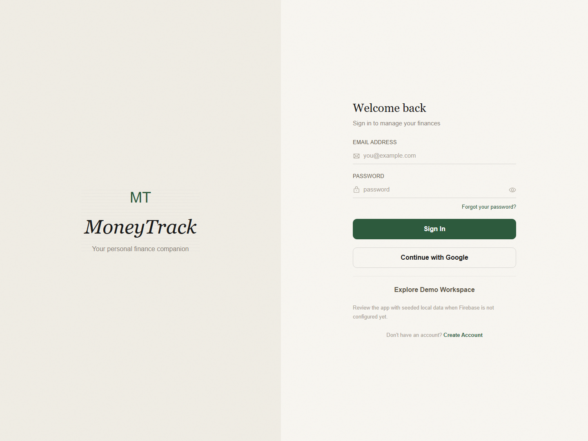
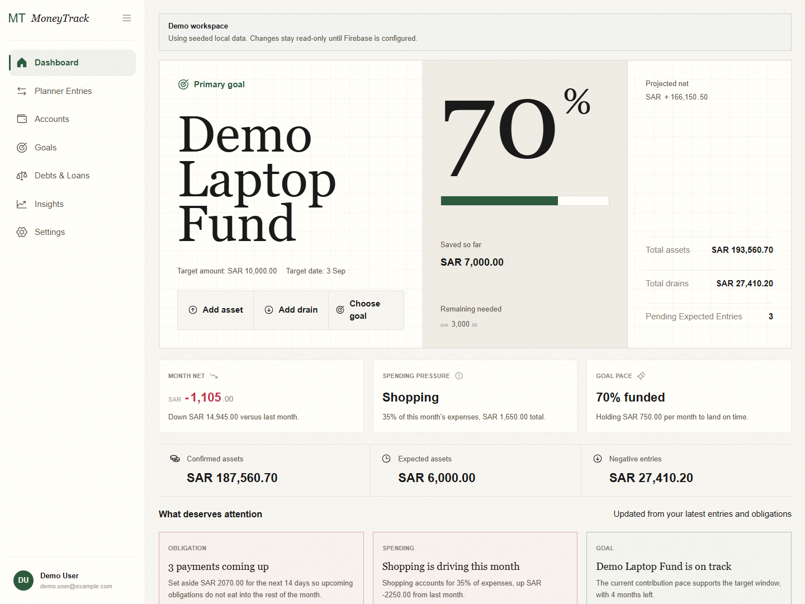
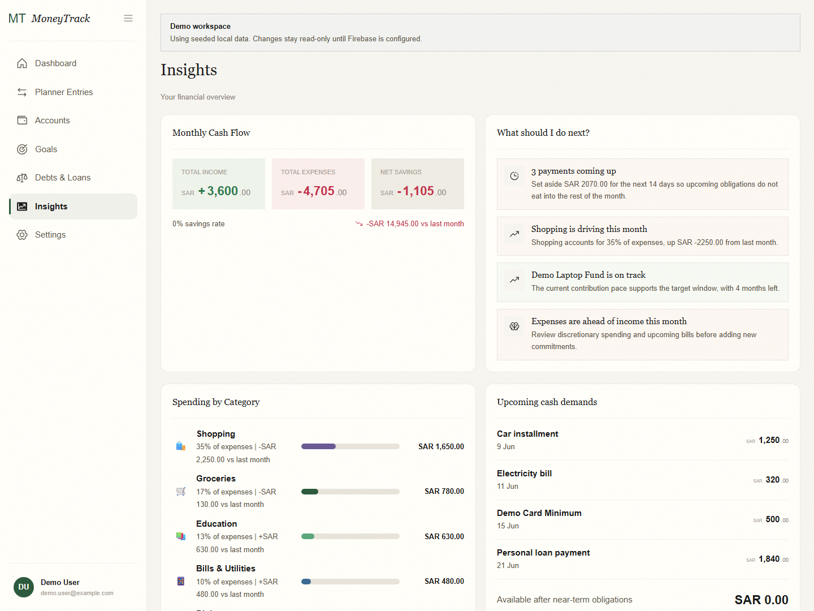

# MoneyTrack

MoneyTrack is a React + TypeScript personal finance app for tracking expenses, planning obligations, setting goals, and managing Firebase-backed money data flows.

## Understand It In 60 Seconds

MoneyTrack gives you a working personal finance app, not a landing page shell. You can review it in two ways:

1. Run `npm install` and `npm run dev`.
2. Open the login screen.
3. Click `Explore Demo Workspace` to inspect the signed-in app without Firebase setup.

If you want the real auth and persistence flow, add Firebase web app config to `.env.local` and use email/password or Google sign-in.

## Why This Exists

MoneyTrack is built as a practical finance tracker and as an open-source portfolio project. The goal is to show real application engineering: authentication, persisted user data, financial entities, clear UX, documentation, and honest project maintenance.

This is an active prototype, not bank-grade software, financial advice, or a certified accounting product.

## What It Does

- Tracks accounts, balances, income, expenses, and transfers.
- Models planning entries as money coming in or going out.
- Tracks savings goals and goal progress.
- Tracks debts, loans, installments, and reminders.
- Uses Firebase Authentication for email/password and Google sign-in.
- Stores user-owned data in Cloud Firestore under each signed-in user.
- Supports SAR-focused formatting. Arabic localization is planned, but currently falls back to English until the translation file is repaired.

## What A Reviewer Can Verify Quickly

- The login screen works without fake hosted-demo claims because the repo includes a read-only local demo workspace.
- The signed-in product has real route surfaces for dashboard, entries, goals, obligations, insights, and settings.
- Balance, planner, and reminder flows are backed by typed store logic rather than placeholder JSON rendering.
- Lint, build, unit tests, and Playwright smoke tests all run locally.

## Current Feature Status

| Area | Status |
| --- | --- |
| Email/password auth | Implemented |
| Google sign-in | Implemented, requires Firebase provider/domain setup |
| Local demo workspace | Implemented for review without Firebase |
| Accounts and balances | Implemented |
| Income, expenses, and transfers | Implemented with balance update logic |
| Planning entries | Implemented |
| Goals and progress | Implemented |
| Debts, loans, installments, reminders | Implemented prototype |
| Firebase security rules | Basic owner-only rules, needs emulator tests |
| Arabic localization | Disabled via English fallback until translation repair |
| Import/export | Planned |
| Screenshots/live demo | Planned, not faked |

## Tech Stack

- React 19
- TypeScript
- Vite
- React Router
- Zustand
- Firebase Authentication
- Cloud Firestore
- Phosphor Icons
- Playwright for auth-flow smoke testing
- Vercel deployment scripts

## Screenshots and Demo

This repository does not claim a fake hosted demo. The intended review path is local:

- Start the app.
- Use `Explore Demo Workspace` on the login screen.
- Move through dashboard, insights, obligations, and entries without touching Firebase.

MoneyTrack also bootstraps new Firebase users with clearly fake starter records from `src/lib/data/demoData.ts` so the product is reviewable without real financial data. Do not use real finance screenshots in issues or pull requests.

Desktop login



Desktop dashboard



Desktop insights



## Local Setup

```bash
npm install
cp .env.example .env.local
npm run dev
```

Fill `.env.local` with Firebase web app config for a Firebase project you control. Do not commit `.env.local`.

If you only want to review the product locally, you can also start the app without Firebase config and use the login page's `Explore Demo Workspace` action. Demo mode is read-only and uses seeded local data.

## Environment Variables

MoneyTrack reads these Vite variables:

```bash
VITE_FIREBASE_API_KEY=
VITE_FIREBASE_AUTH_DOMAIN=
VITE_FIREBASE_PROJECT_ID=
VITE_FIREBASE_STORAGE_BUCKET=
VITE_FIREBASE_MESSAGING_SENDER_ID=
VITE_FIREBASE_APP_ID=
```

These are Firebase web app config values, not Firebase Admin SDK private keys. Keep local env files out of Git.

## Firebase Setup

1. Create a Firebase project.
2. Register a web app and copy the web app config into `.env.local`.
3. Enable email/password sign-in.
4. Enable Google sign-in if you want to test Google auth.
5. Add your local and deployed domains to Firebase Authentication authorized domains.
6. Deploy or review `firestore.rules` so users can access only their own `users/{uid}` document tree.

## Vercel Deployment

This repository includes Vercel scripts and `vercel.json` SPA rewrites.

```bash
npm run build
npm run host:vercel
```

The local `.vercel/project.json` link is intentionally not committed. If Vercel auth is needed, run `npm run vercel:login`.

## Available Scripts

- `npm run dev` starts Vite on port 5000.
- `npm run build` runs TypeScript build and Vite production build.
- `npm run lint` runs ESLint.
- `npm run test:unit` runs Vitest finance calculation tests.
- `npm run preview` previews the production build.
- `npm run test:e2e` runs Playwright auth-flow smoke tests.
- `npm run test:e2e:ui` opens Playwright UI mode.
- `npm test` runs unit tests and Playwright smoke tests.
- `npm run host:vercel` deploys to the linked Vercel project.

## Testing and Quality

Current checks:

- ESLint passes with `npm run lint`.
- TypeScript and Vite build pass with `npm run build`; route and vendor chunks are split to avoid Vite's large-chunk warning.
- `npm audit --audit-level=high` currently reports 0 vulnerabilities after removing the local Vercel CLI dependency.
- Vitest covers core finance calculations and static Firestore rules invariants.
- Playwright covers anonymous root redirect, login rendering, signup validation, forgot-password navigation, a narrow mobile viewport check, and the signed-in demo workspace flow across dashboard, insights, and obligations.

The test suite is still intentionally focused. Emulator-backed Firestore rules tests, repository write tests, authenticated data-flow e2e tests, and broader route coverage are roadmap items.

## Project Status

MoneyTrack is in active development. Core app surfaces exist, but the project still needs stronger Firebase emulator coverage, repaired Arabic localization, better demo screenshots, Firestore rules validation, and more complete recurring obligation logic.

## Security and Privacy Notes

- Do not commit `.env.local`, tokens, private keys, or real financial data.
- Do not share real finance screenshots in public issues.
- Firestore rules currently restrict user document trees by authenticated UID.
- Client-side validation is not a security boundary.
- See `SECURITY.md` for reporting and contributor guidance.

## Roadmap

See `docs/roadmap.md` for the current roadmap. Near-term priorities are screenshots, localization cleanup, finance calculation tests, better Firebase error states, mobile QA, and import/export support.

## Documentation

- `AGENTS.md` explains how coding agents should work in this repository.
- `docs/architecture.md` explains app structure and data flow.
- `docs/backend-plan.md` records backend data-flow expectations.
- `docs/data-model.md` documents implemented and planned finance entities.
- `docs/codex-use-cases.md` explains practical Codex maintenance use cases.
- `docs/application-summary.md` contains paste-ready application text.

## Contributing

Contributions are welcome when they are focused and honest about scope. Start with `CONTRIBUTING.md`, run the available checks, and avoid posting sensitive user data.

## License

MIT. See `LICENSE`.
